# Nioh 3 Engine

> **Warning: this mod has NOT been tested in online co-op.** Use it offline, or at your own risk online. Back up your saves first.

Open-source engine fixes, boss practice add-ons and reverse-engineering research for **Nioh 3 on PC (Steam, game version 2.02)**.

> **Unofficial fan project.** Not affiliated with, endorsed by or supported by Koei Tecmo or Team Ninja.
> **No game files are included** in this repository or its downloads (no executable, archives, shaders, dumps or saves).
> You need your own legal copy of Nioh 3 on Steam. Back up your saves before installing any mod.
> What was deliberately left out: [PUBLIC_EXCLUSIONS.md](PUBLIC_EXCLUSIONS.md).

## Features

Everything works in the game's memory while it runs. Close the game and it is gone; the mods check the game build and
do nothing on any version other than 2.02.

**Nioh3EngineFix** (engine fix, [`mod/Nioh3EngineFix/`](mod/Nioh3EngineFix/), version 1.7.86 in this source)
- **Real game speed below your fps cap.** Stock Nioh 3 runs the whole game in slow motion when it cannot hold its cap;
  with the mod it stays at 1.00x speed down to a floor (48 fps at the 120 cap, 24 at 60). Pauses itself online.
- **Much faster loading under Proton / Linux** (ROG Ally X: about 96 s -> 38 s per save load). Windows loading is unchanged.
- **Less wasted CPU and power.** Engine threads that spin while waiting are made to sleep; this matters most on handhelds.
- **Optional Extra Performance presets** (off by default): about +3 % (Performance) and +10 % (Potato) fps, with small image changes.
- **Frame generation guard under Proton**, which avoids a game crash with frame generation on.
- **In-game mod menu** (F10, Esc x3, or triple-tap Start): every fix switchable live, plain-language help per row,
  tab bar with LB/RB, FPS / frame-time overlay, controller and input display.
- **Game HUD toggles:** hide the whole HUD or single parts (health/Ki, shortcuts, style, stance, guardian, Amrita,
  money, enemy health bars, lock-on marker).
- **Save files page:** switch between save sets with verified backups, from the menu or the title screen.
- **Reverse Mods:** one menu row turns the mod off (or back on) for the next start; installers also ship
  "Restore Vanilla Game" and "Put the mod back" shortcuts (Windows and Linux).
- **Diagnostics:** hitch logger, load-time stats, GPU/CPU profilers, and a crash/issue report file.

**Nioh3BossRematch** ([`mod/Nioh3BossRematch/`](mod/Nioh3BossRematch/), add-on 1.4.22): refight bosses you have
already beaten from an overlay menu, spawning in the boss arena, plus Boss Matches; optional boss-fight logger for modders.

**Nioh3Training** ([`mod/Nioh3Training/`](mod/Nioh3Training/)): boss practice tools: per-boss move lists with move
toggles, frame meter and Ki / I-frame ring meter, practice stats, boss vitals and drills.

Each mod works on its own; together they share one `dinput8.dll` loader and one menu.

## What it looks like

A live capture from the 1.7.86 build (Windows, 2560x1440, 120 fps): the in-game **mod menu** open on *Display > Game HUD*
(right; every part of the game HUD has its own hide switch plus a master switch, here the whole HUD is hidden), the
**FPS / frame-time overlay** (top left: FPS, frame generation state, frame time, game speed factor), the **controller
display** (faint Xbox-style pad, top left), the **input display** (frame counts and pressed buttons, left), and the Training
**frame meter** (bottom: PLAYER and I-FR rows with startup / active / recovery frames and the colour legend).

### More of the mod menu

| | |
|---|---|
| 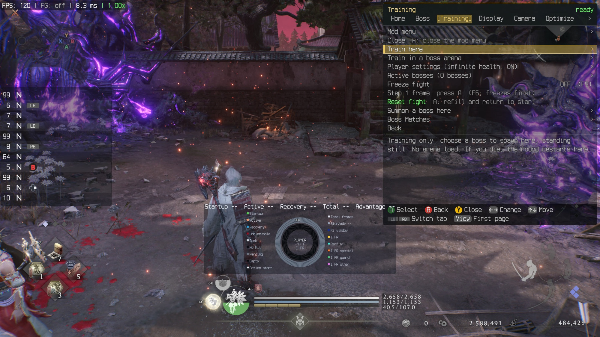 **Training tab** - train here, summon a boss, freeze / step a fight, reset fight, boss matches. The overlay shows the input display and the ring frame meter. | 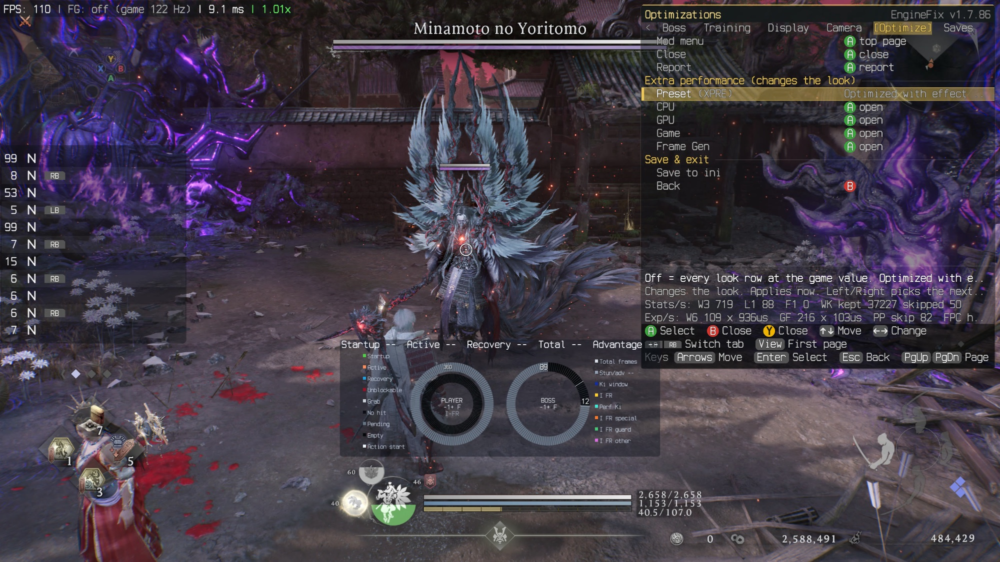 **Optimize tab** against Minamoto no Yoritomo - performance presets (CPU / GPU / Game / Frame Gen), with the **ring frame meter** showing PLAYER and BOSS frame data and the colour legend. |
| 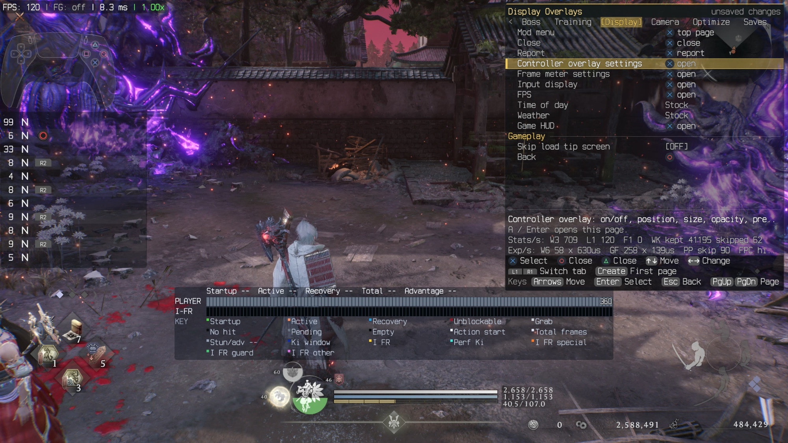 **Display tab** - controller overlay (here a PlayStation pad), frame meter, input display, FPS, time of day, weather, Game HUD. The bottom bar is the **row-style frame meter**. | 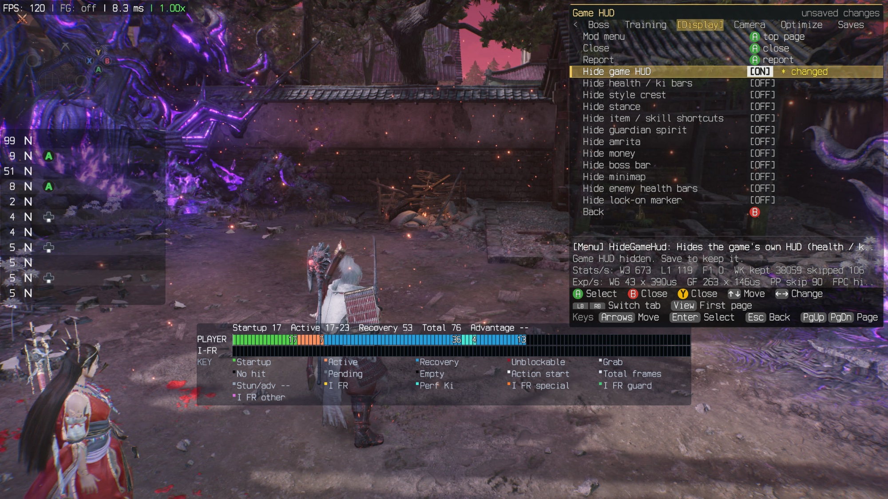 **Game HUD sub-menu** - a master switch plus one switch per HUD element (health / ki, style crest, stance, item shortcuts, guardian spirit, amrita, money, boss bar, minimap, enemy health bars, lock-on marker). |
| 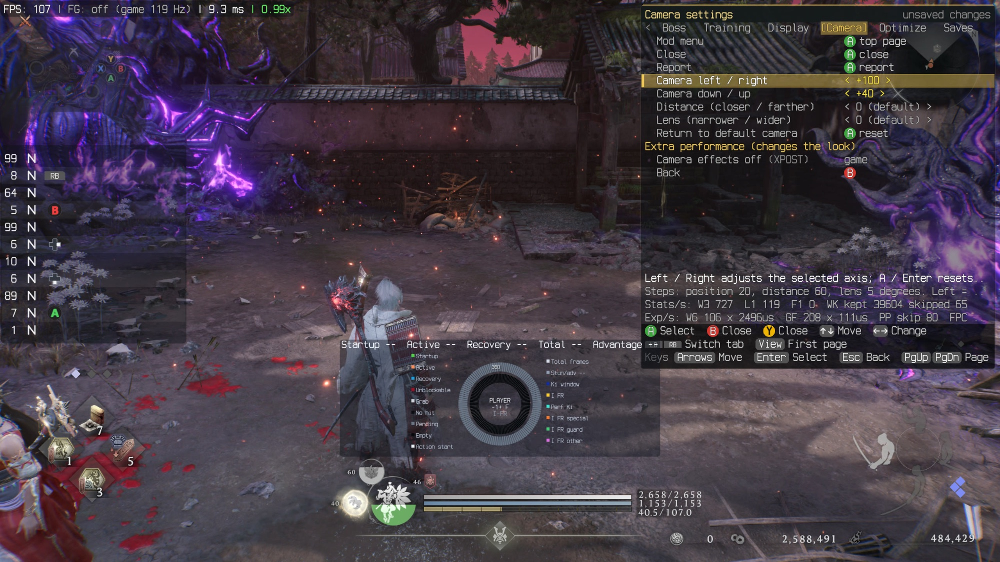 **Camera tab** - move the camera left / right / up / down, distance and lens, with a one-press reset to the default camera. | 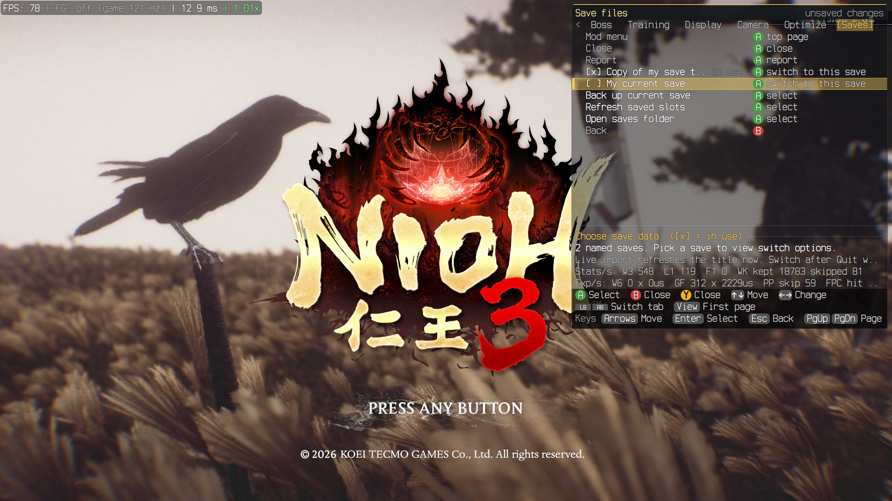 **Saves page** on the title screen - "Choose save data" lists your save files with a check mark on the one in use; switch, back up, refresh or open the saves folder. |

## Install

Releases are on the [**Releases**](../../releases) page. The player guide (Windows and Proton / Steam Deck / ROG Ally,
automatic save backups, uninstall) is [release/USER_GUIDE.md](release/USER_GUIDE.md). In short: close the game,
extract the zip, run `Install-Mod.cmd --game-dir "<Nioh 3 folder>"` (Windows) or
`sh install-mod.sh --game-dir ... --proton-prefix ...` (Linux), and on Proton add the launch option
`WINEDLLOVERRIDES="dinput8=n,b" %command%`.

Free wins you can do yourself: turn **FPS dynamic adjustment** OFF in the game's settings, run your desktop at the
monitor's full refresh rate (the 120 fps option is hidden below 118 Hz), and turn on **Resizable BAR / SAM** if your GPU supports it.

## Performance: honest numbers

Every number is backed by a capture: [docs/BENCHMARKS.md](docs/BENCHMARKS.md) (controlled A/B results and the
retracted early claims) and [docs/final-bench/report.md](docs/final-bench/report.md) (final build, 2026-10-24).
Why the game runs badly, every optimization tried (including the failures), and what is still open:
[docs/WHY_NIOH_RUNS_BADLY.md](docs/WHY_NIOH_RUNS_BADLY.md).

Final bench, Yoritomo fight, average presented fps, two chunks per arm ("pure-perf" = same-picture fixes only,
"full" = also the optional visual presets):

| Device | FG | Stock | Pure-perf | Full |
|---|---|--:|--:|--:|
| PC: Ryzen 5 7600X + RX 9070, 1440p, Windows | off | 75.84 | 98.46 | 98.78 |
| PC: same | on | 141.42 | 144.41 | 151.58 |
| PC2: Ryzen 5 5600X + RX 6650 XT, Windows (slow 0.8 GB/s GPU link) | off | 41.72 | 46.87 | 47.32 |
| PC2: same | on | 77.07 | 73.59 | 74.30 |
| ROG Ally X, Bazzite / Proton | off | 34.63 | 32.58 | 39.02 |
| ROG Ally X, same (displayed fps) | on | 42.06 | 44.65 | 52.38 |

Caveats: two chunks per arm in one fight; the Ally chunks vary widely; on PC2 with FG on stock is ahead; the earlier
controlled same-picture A/B on the PC found 0 to +2.5 %, so treat the PC FG-off gap as indicative until it is
reproduced. Tested on AMD hardware only (two Windows PCs and a ROG Ally X); NVIDIA, Intel Arc and Intel CPUs are
untested. Reports from other hardware are welcome; please attach `Nioh3EngineFix.log`.

## Repository layout

| folder | what it is |
|---|---|
| [`mod/`](mod/) | all mod source and offline tests: `Nioh3EngineFix`, `Nioh3BossRematch`, `Nioh3Training`, `Nioh3CamKiProbe` (diagnostic), plus shared menu/settings code |
| [`release/`](release/) | installer, uninstall/restore scripts, packaging and release checks, player guide |
| [`tools/saves/`](tools/saves/) | the save-file helpers the engine fix's Saves page uses (built into the package by `build.bat`) |
| [`symbols/`](symbols/) | symbol database: about 16,000 named functions, globals and structs in `Nioh3.exe` v2.02 (RVAs only), with x64dbg / IDA / Ghidra scripts |
| [`research/`](research/) | our reverse-engineering notes: renderer (all 11 packages), frame timing, loading, jobs, profiles |
| [`docs/`](docs/) | benchmarks, final bench charts, why-it-runs-badly report, code map, engine subsystem write-ups, progress charts |
| [`tools/progress/`](tools/progress/) + [`data/`](data/) | scripts and our own address tables that build every chart and the code map from your own copy of the game |

## Decompilation progress

-orange)   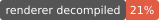

**In plain words:** 12,679 of the game's 211,206 functions (6 %) have real names so far. Those names cover all of the
CPU time we measured in our profiles, and every GPU pass we captured (59 of 59) points at the engine code that runs it.
The full-game chart stays mostly grey on purpose: we name code that matters for performance first, not the whole game.
This is understanding the engine, not a full source rebuild. Charts as of 2026-10-11, regenerated from `symbols.tsv`.

### The whole game

Every function in `Nioh3.exe`, grouped by what the code is for ([docs/code-map.md](docs/code-map.md)). Block size =
code size; green = has a real name, grey = not named yet.

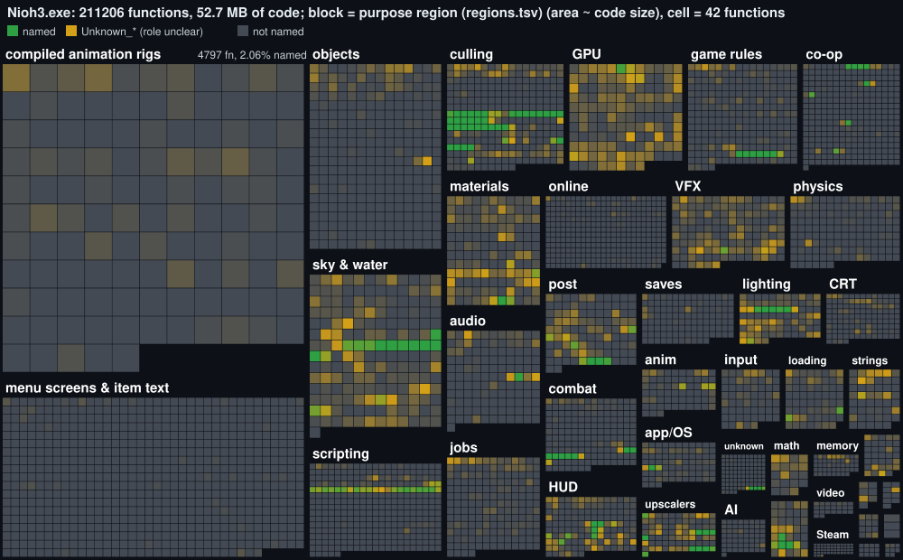

### The code that costs CPU time

Only the functions that show up in our CPU profiles (ROG Ally + PC, self time). Block size = share of profiled time.

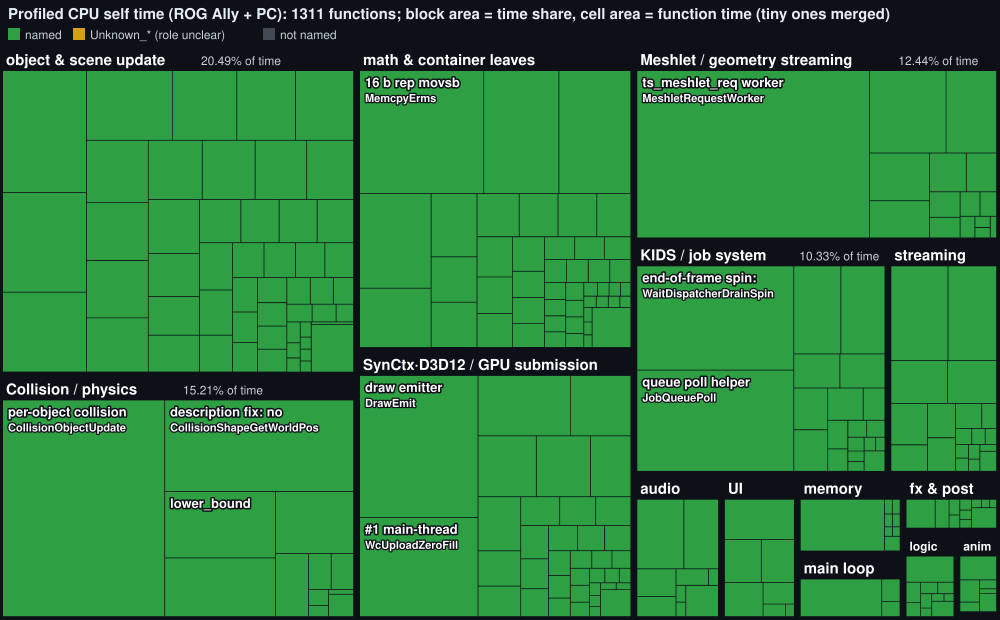

### GPU time

One GPU capture on the ROG Ally, the 118 most expensive shader buckets (20.7 ms of a 30.1 ms frame). Area = time per
frame. Green = shader/pass identified; blue = a faster replacement we kept in private tests (not distributed); red = a
rewrite we tried and dropped. These are ranking numbers from a profiler, not isolated costs.

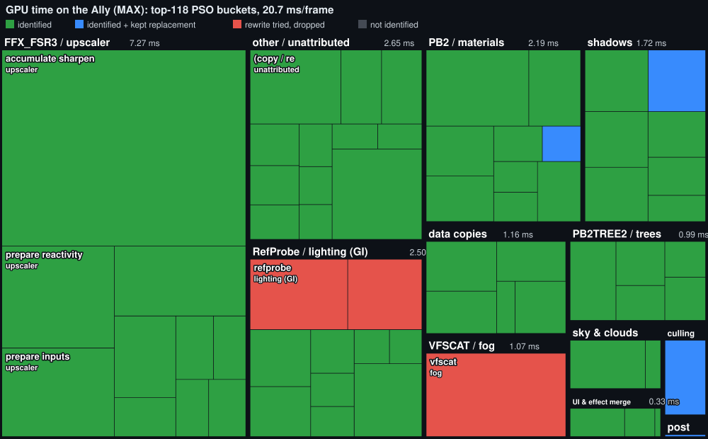

### The rendering engine

The renderer on its own: 54,295 functions in 11 packages. **20.7 % of its code (by bytes) is understood.**

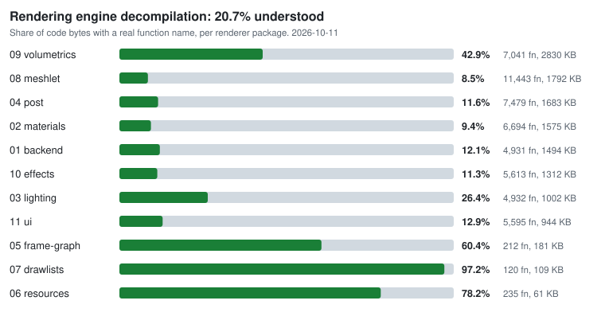

| Package | Functions | Code | Understood (bytes) |
|---|--:|--:|--:|
| 01 backend (D3D12) | 4,931 | 1,494 KB | 12.1 % |
| 02 materials | 6,694 | 1,575 KB | 9.4 % |
| 03 lighting | 4,932 | 1,002 KB | 26.4 % |
| 04 post-processing | 7,479 | 1,683 KB | 11.6 % |
| 05 frame graph | 212 | 181 KB | 60.4 % |
| 06 resources | 235 | 61 KB | 78.2 % |
| 07 draw lists | 120 | 109 KB | 97.2 % |
| 08 meshlet / geometry | 11,443 | 1,792 KB | 8.5 % |
| 09 volumetrics | 7,041 | 2,830 KB | 42.9 % |
| 10 effects | 5,613 | 1,312 KB | 11.3 % |
| 11 UI | 5,595 | 944 KB | 12.9 % |
| **Total** | **54,295** | **12,983 KB** | **20.7 %** |

Core functions per package (bar = named; the thin bar = nearby functions only guessed to be renderer code):

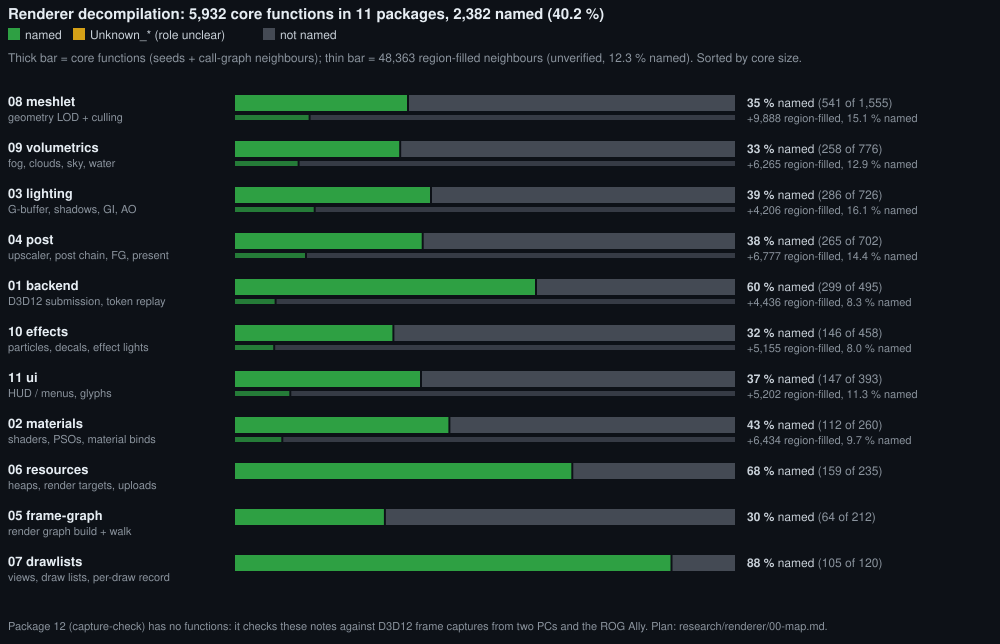

Per-subsystem write-ups (what it does, data structures, hot addresses, threads, costs):
[docs/subsystems/](docs/subsystems/).

## Currently open

As of 2026-10-29. See section 5 of [docs/WHY_NIOH_RUNS_BADLY.md](docs/WHY_NIOH_RUNS_BADLY.md) for the full list with expected gains.

- First-sight PSO compile hitches (the PSO journal prewarm is built, default off, and promising).
- The single D3D12 replay (dispatcher) thread is the CPU wall on mid-range PCs; frame overlap stays **NO-GO**.
- Ally loading: the remaining Continue window is engine readiness gates, not disk.
- Decompilation of the least understood renderer packages (meshlet, materials, effects, post-processing).

## Help decompile the game

Anyone can add names to the symbol database: no coding needed, just a disassembler and your own copy of the game.
Everything we know is public: the names ([`symbols/`](symbols/)), the reasoning behind them ([`research/`](research/)),
and the tools that draw the progress charts ([`tools/progress/`](tools/progress/)), so you can pick up exactly where we are.
Setup, priorities and how to send a pull request: [CONTRIBUTING.md](CONTRIBUTING.md).

## Building

The engine fix and the rematch add-on build with MSVC (x64 C++ tools) and the Windows SDK: run `build.bat` in the
mod's folder (it finds Visual Studio / Build Tools through vswhere). The Training add-on builds with zig's clang:
`mod/Nioh3Training/build.sh` (`pip install --user ziglang`). Offline tests live in each mod's `tests/` folder; tests
that check byte patterns need your own copy of the game executable, passed on the command line. Paths such as
`C:\nioh3-engine\...` in test scripts are the maintainers' defaults; pass your own. `release/package_final.py` and
`release/check_release.py` build and verify a release zip.

## License and credits

Code and documentation in this repository: [MIT](LICENSE). The overlay font in `mod/Nioh3EngineFix/src/osd_font.h` is
derived from Inconsolata (SIL Open Font License 1.1). Controller display art: see
`mod/Nioh3EngineFix/assets/padviz/CREDITS.txt` (CC BY 3.0 and MIT sources). The release zips include the Ultimate ASI
Loader by ThirteenAG (MIT). Nioh 3 is a trademark of Koei Tecmo; this project uses no game assets.

This work builds on many community mods, tools and write-ups: [CREDITS.md](CREDITS.md).
