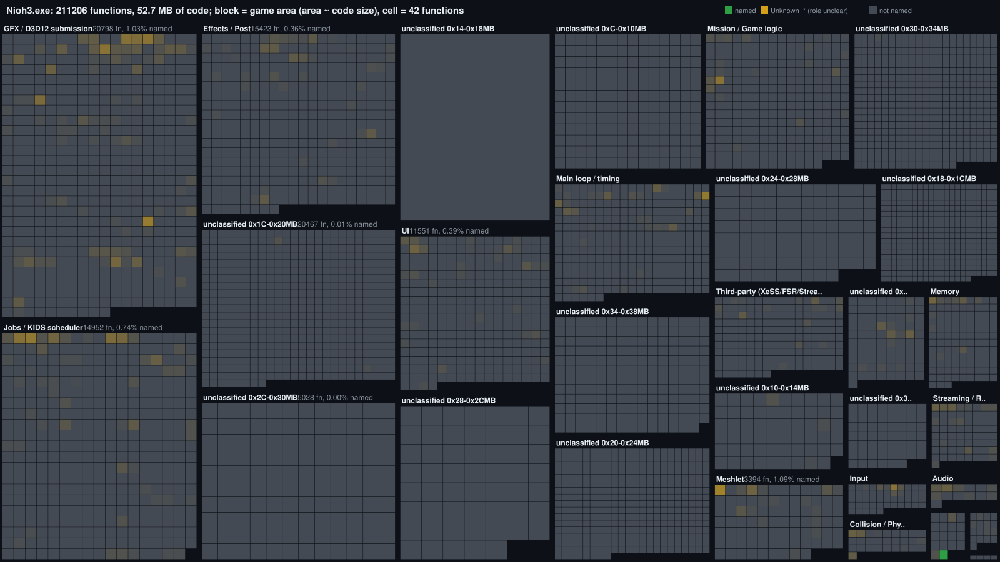
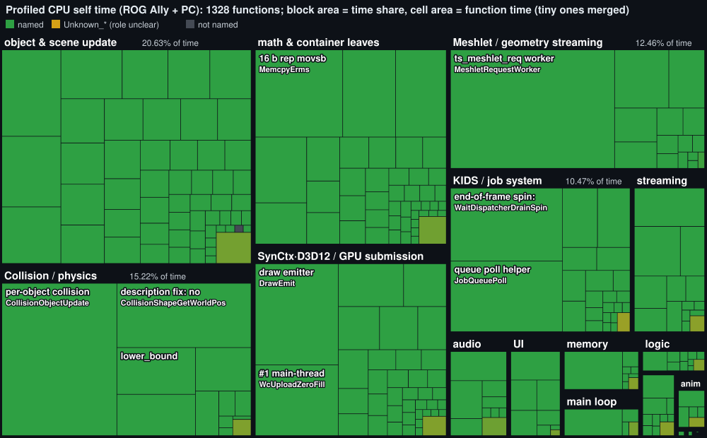
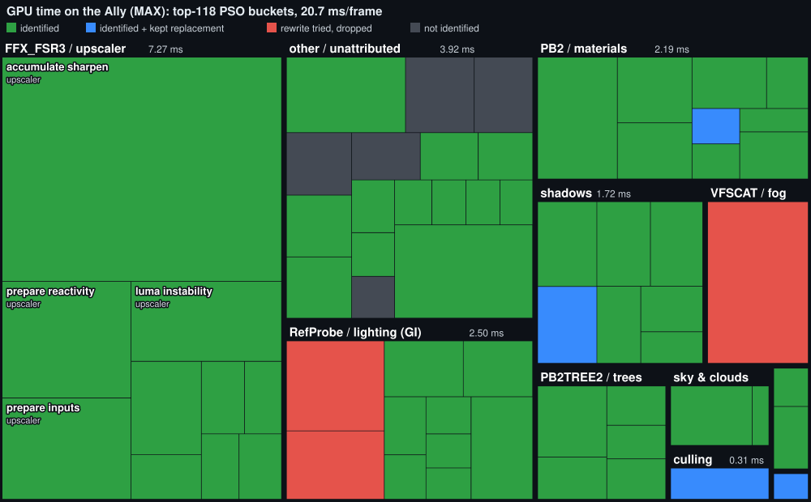

# Nioh 3 PC: what's hurting performance, and how we fixed it

Work-in-progress findings from reverse-engineering Nioh 3 (Steam, **v2.02**, Team Ninja's in-house engine) to find out why it runs worse than it should, and fixing it at the engine level. No game files were modified for the engine fixes: they're applied to the running game's memory and disappear when it closes.

**Test machine:** Ryzen 5 7600X (6 cores / 12 threads), 32 GB DDR5-4800, Radeon RX 9070, 2560×1440 240 Hz monitor, NVMe SSD, Windows 11.

---

## TL;DR

| | Before | After | Change |
|---|---|---|---|
| Average fps | 59.4 | **~103** (clean session; 109 in a lighter scene) | +74% |
| 1% low fps | 53.5 | **~81** (clean; 97 in the lighter scene) | +52% |
| Stutter spikes (frames over 2× the average frame time, per 20–30 s) | 3–6 | **0–2** | |
| Game speed at in-between framerates | 0.90× (slow motion + judder) | **1.00×** | fixed |
| Render resolution | 65% (dynamic, down to 50%) | **75% fixed, FSR4** | sharper |

Most of the raw fps came from **setup** (the monitor was running at 60 Hz, and the settings were tuned for the wrong bottleneck). The **engine patches** then fixed the judder and slow motion, removed the stutter spikes and raised the 1% lows by 10%.

---

## Will this work on my PC?

**Short answer: yes. It works on NVIDIA, Intel Arc and any AMD graphics card, and on Intel or AMD processors.** It
needs Steam Nioh 3 **v2.02**; on any other version the mod does nothing. We have only tested it on AMD hardware (RX 9070
desktop, ROG Ally X), so we checked the code for anything that depends on the GPU or CPU brand. Nothing switched on by
default does (details: `notes\hardware-compatibility.md`):

- **Engine fixes** (smooth game speed below the fps cap, the main-thread fixes, the spin-wait fixes): they change the
  game's own CPU code, not the graphics driver. They use only basic x64 instructions (nothing AVX-only) and make no
  assumptions about core counts. **They help any PC where the processor is the limit.** A slower CPU gains more.
- **Faster shadow shader** (optional file): a standard DirectX 12 shader with no AMD-only tricks, and the same picture
  on every GPU. The fps gain was measured on AMD only; elsewhere expect a small gain, and only when the graphics card
  is the limit.
- **Overlay and mod menu (F10):** standard DirectX 12 drawing. They work on every GPU. The "FG FPS" label is tuned for
  FSR frame generation; with DLSS or XeSS frame generation it may show the wrong frame-gen status (display only).
- **Frame-gen presenter fix:** helps only with **FSR** frame generation, which also runs on NVIDIA and Intel. It does
  nothing with DLSS or XeSS frame generation.
- **Faster loading (EP/SR):** helps only on Linux / Steam Deck / ROG Ally under Proton, with any GPU. On Windows,
  loading is already fast in that spot, so these stay off by themselves.
- **Leave these off unless you have an AMD GPU:** `AS0` (risky on Intel Arc, does nothing on NVIDIA),
  `[GpuOpt] R2a / R2b / R1` (built for the Linux AMD driver) and `[GpuOpt] Barriers` (measured slower). All of them
  are already off by default.

---

## What the game does wrong, and what we did (at a glance)

One line per problem: what the game does -> effect -> our fix -> result. Scope: **Ally** = ROG Ally X / Proton only, **PC** = native Windows only, **both**. Details: "What's ruining performance in Nioh 3" below and `MODLOG.md`.

| Problem (scope) | Effect | Our fix | Result |
|---|---|---|---|
| Game time advances a fixed 1/60 or 1/120 s per rendered frame (both) | Below the fps cap the whole game runs in slow motion (0.90x at 108 fps) and the camera judders | VRR / variable-dt frame timing | Game speed 0.90x -> 1.00x (PC, measured) |
| CPU spin-waits: window message loop, render-start wait, frame limiter, FSR frame-gen pacing thread (both) | Burns CPU, power and heat while waiting | Sleep/wait fixes (W3, W6, GF, R1, L1, DS) | Less CPU and power, fps-neutral |
| Main thread clears a write-combined GPU buffer with a read-before-write instruction, W12 (both) | Every write stalls: 11-22 % of the main thread | W12 | Measured on PC; see README benchmarks |
| Frame-latency waitable handle fetched every frame and never closed (PC) | Leaks one handle per frame (216k per hour at 60 fps) | WL | Leak confirmed in a harness; no-op under Proton |
| Loads do about 540k tiny file reads, each creating and closing a Windows event (both; costly on Ally) | 84 us per event under Proton vs 0.6 us on Windows | EP (event pool, auto-on under Proton) | Ally Level 136 load ~94 s -> ~45-47 s; no PC gain |
| Cached reads go through overlapped I/O (Ally) | Expensive under Proton | SR (auto-on under Proton) | Ally load -> 38.5 s (-59 % total) |
| Load queue capped at 10 requests in flight while threads and disk idle (both) | Possible load slowdown | LC (cap 16) | Ally: not yet tested; PC: no change measured |
| Post-load tip page waits for a button press (both) | Load never ends by itself | AutoContinueLoad | Optional (off by default): mod-menu row "Skip loading tip screen" skips the page; works on PC and Ally |
| First-use PSO creation under a lock blocks the frame (both) | Hitches on first use of an effect | PJ (PSO journal + prewarm) | Built, not yet tested |
| GHDM shadow shader is inefficient on the Ally's GPU (Ally) | GPU is ~99 % busy; shadows are a large share | Replacement GHDM shader | +6.4 to +8.7 % fps at MAX (measured) |
| Barrier batching (PC) | Costs the PC about 7 % | Kept off (`Barriers` / R-series off on PC) | Measured: -7 %, so off |
| Other CPU waste (DQ, P1E7, GIMerge, wdo14) | Small main-thread/GPU costs | Built | Not yet tested |

---

## Decompilation progress

-orange)    

**In plain words:** we have given a name to 6,787 of the game's 211k functions (3.2 %), but those cover 99.99 % of the CPU time we measured (100.00 % counting `Unknown_` functions that are described but not fully understood), and every GPU pass (59 of 59) points at the engine code that runs it. The full-game graph stays mostly empty by design: we only name code that matters for performance, not the whole game. The performance and GPU graphs are full. That is what the speed work needs; it is not a full source rebuild.

**Latest (2026-10-08):** the registry that creates the GPU passes was walked automatically, and **1,142 names** (70 render nodes, 216 shader objects, 483 data objects, plus type-info stubs) were added, so every GPU pass has a named CPU entry point (`notes
ender-nodes.md`). The charts below were regenerated after that merge.

Every function in `Nioh3.exe` (211k function starts from `.pdata`), grouped by purpose region ([docs/code-map.md](docs/code-map.md)); block size = code size, each cell = 42 functions, green = real name, amber = `Unknown_*` (described, role unclear), grey = not named yet:

Only the functions that show up in our CPU profiles (ROG Ally + PC, self time); block size = share of profiled time:

GPU time on the ROG Ally at MAX (one all-original-shaders GP2 capture, top PSO buckets, area = ms/frame): green = identified shader/pass, blue = identified and we ship a kept replacement, red = a rewrite we tried and dropped (slower on RADV), grey = not identified:

Per-subsystem write-ups (role, data structures, hot RVAs, threads, cost drivers): [docs/subsystems/README.md](docs/subsystems/README.md).

What each block of the full-game chart is for (label, size, share, confidence, method): [docs/code-map.md](docs/code-map.md).

GPU numbers are stamp-inflated ranking data, not isolated costs. Regenerate with `py -I re\scripts_re\progress_treemap.py` (`--check` prints the numbers only). Area grouping is inferred from symbol names, so it is approximate.

---

## Your device: one zip for everything

Plain version: the game is limited by different things on each machine, so a few settings differ. You do not choose a profile: there is **one universal zip** (`release\dist\Nioh3EngineFix-<version>.zip`, install steps in `release\USER_GUIDE.md`). At startup the mod detects Windows vs Wine/Proton and resolves the settings marked `-1` (auto) in the ini; the log lists what each one became.

### Handhelds and Linux (Proton): ROG Ally X as the reference
- **Hardware measured:** ASUS ROG Ally X (RC72LA, Ryzen Z1 Extreme 8C/16T, Radeon 780M, 24 GB with 8 GB as GPU memory, 1080p 120 Hz, Bazzite + Proton / vkd3d-proton / RADV). We never change hardware or BIOS settings.
- **What limits it:** the graphics chip is about 99 % busy. Stock at MAX settings in Futamata is about **16 fps** (16.3-16.8 measured).
- **What helps:** the **GHDM shadow shader** (+6.4 to +8.7 % fps at MAX) and the **fog shader `0xa9910db8`** (a further +0.15 to +0.30 fps, measured on the Ally). The CPU fixes (W6, GF, WK, WG, CP, SPF, LK, ED ...) are fps-neutral there (they cut CPU load and free power for the GPU). R2a/R2b/R1 (barrier rewrites, Proton only) are no-ops.
- **Loading:** stock about 94 s (Level 136) -> about **37-38 s** with EP + SR, which switch on automatically under Proton.
- **Tested and not kept:** LC (higher load queue cap) measured worse, so it stays off; PF (load prefetch) was neutral. PJ, DQ, P1E7, GIMerge and wdo14 are built but not yet proven.

### Windows desktop (reference: Ryzen 5 7600X + Radeon RX 9070, 1440p, Windows 11)
- **What limits it:** the CPU main thread (one core does most of the game's work), not the GPU.
- **What helps:** the CPU fixes (W3, W6, P12, WL and friends). Stock all-off baseline standing: about 149-153 fps, p99 frame time 14.3-14.7 ms. Kept on PC: PP (+2.9 %, -0.26 ms); B, GF and MQ were dropped (no gain).
- **Loading:** about 13.5-15 s warm. EP/SR give no PC gain (a native event costs 0.6 us vs 84 us under Proton), so they stay off on Windows. The "Skip loading tip screen" option (AutoContinueLoad) is off by default.
- Smart App Control can block unsigned DLLs.

### Install (both)
Download the zip, copy `dinput8.dll`, `Nioh3EngineFix.asi` and `Nioh3EngineFix.ini` next to `Nioh3.exe`. On Proton add the Steam launch option `WINEDLLOVERRIDES="dinput8=n,b" %command%`. The shader files in `optional\shader_dx12\` are optional (back up the originals first). Menu: Esc x3, F10, or Start x3. Step by step: `release\USER_GUIDE.md`. (`mod\ally-package` is no longer an install path.)

## Boss research (for a future rematch feature)

**In plain words**
- Nothing here changes the game yet. It is groundwork for a possible "fight a boss again" feature.
- We know the game's boss list: 110 boss mission scripts, and 82 of those bosses are identified by name and stats.
- The cleanest way to refight a boss is the game's own Battle Scrolls (Emaki): a built-in "this stage, this boss only" mission that does not touch story progress.
- The save-file encryption is solved (we can read and re-write a copy of a save), and the mod can tell when you are in an online session, so a rematch can switch itself off in co-op.
- Still to do: in-game boss logging (BossLog, written but not yet run in the game) and a save diff of a real boss kill to find where "defeated" is stored.

**Technical detail**
- Master table: [notes/boss-master.csv](notes/boss-master.csv) (209 rows = 110 script rows + 99 web-only rows; 82 with boss char id / enemy record); how it is built: `notes\boss-master.md`.
- Rematch paths, ranked: Battle Scrolls = Emaki mission 0xCC96 via `EmakiMissionRequest` (0x10DBED0), then the shrine mission-replay menu, then the raw mission-start queue. Details: `notes\boss-rematch-paths.md`.
- Save cipher: AES-128 CTR with a custom S-box, round-trips byte-identical on a copy (`notes\save-format.md`, `re\scripts_re\savecrypt.py`, `savediff.py`). The mission-flag block is not located yet.
- Pending: run BossLog (ASI 1.7.18, `[Debug] BossLog = 1`) in a real fight, and diff a before/after save of one boss kill.

---

## Loading

**In plain words**
- **ROG Ally X (Proton):** a load that took about 94 s (Level 136) now takes about **37-38 s**. The cause was not a timeout (an early theory); the game's file reads are far slower per call under Proton, and the mod now serves them cheaper (EP, SR, switched on automatically under Proton).
- **Windows PC:** a title-to-game load takes about 13.5-15 s warm (about 26 s cold in earlier tests). EP/SR do not help there. We have not found what the last ~15 s of the cold load waits for; the LG probe logs it.
- The loading patches GL1 and LW did nothing measurable and LC (queue cap) was worse, so they stay off. PF (prefetch) was neutral.

**Technical detail**
- Ally: stock 94 -> EP (1.7.24) about 45-50 s -> EP + SR (1.7.25/1.7.28) 38.5 s. The load work ends at about +93 s stock (resource manager A capped at 10 in flight, ~640k ReadFile calls at 68 s in-call vs 3.2 s on PC); the rest of the old 118.7 s window was the tip page waiting for a button press. Details and digests: `notes\loading-ally-fixed.md`.
- PC: 25.8 +-0.5 s cold window; resource managers drain by +9.9..+13.0 s; the remaining 14.6-16.3 s is an unidentified `LoadIsLoadEnd` gate or sequencer state (`notes\loading-bottleneck.md`). `LoadGates = 1` (needs `LoadStats >= 1`) logs which gate holds.

---

## Mod versions (recent)
| ASI | What |
|---|---|
| 1.7.13 | Easier in-game mod menu (Esc x3 / F10 / Start x3) |
| 1.7.14 | Loading flags GL1, LC, LW (default off; no measurable effect) |
| 1.7.15 | Mod-menu reminder always on screen (`PauseHint = 2`) |
| 1.7.16 | Esc x3 toggles the mod menu both ways without opening the pause menu |
| 1.7.17 | LG load-gate probe and `LoadStats = 3` (measurement only); crashed loads on the Ally |
| 1.7.18 | BossLog: read-only boss fight logger (default off) |
| 1.7.19 | Fixes the 1.7.17 LG crash (gate thunks now preserve r10/r11) |
| 1.7.20-1.7.21 | BossLog reward logging; RematchLog (boss-rematch groundwork, read-only, default off) |
| 1.7.22 | "Skip loading tip screen" (AutoContinueLoad); later made off by default (1.7.33) |
| 1.7.23-1.7.24 | EP event pool for archive reads; `-1` = auto (on under Proton): Ally load 98.9 -> 50 s |
| 1.7.25-1.7.28 | Read fixes SR / RC / AQ / TSY / SH; SR auto under Proton: Ally load about 38.5 s |
| 1.7.26 | PF load prefetch (default off; neutral) |
| 1.7.27 | `VRROnline = -1`: frame-timing fix pauses itself in online sessions |
| 1.7.29-1.7.32 | GI light-merge, PJ PSO journal, DQ and P1E7 experiments (all default off) |
| 1.7.33 | AutoContinueLoad off by default |
| 1.7.34-1.7.38 | Test tooling: FnProbe, PadLatency, Tour mode (stability tour), VirtualPad (default off, debug) |
| 1.7.39 | MA main-thread loads, live DQ / P1E7 rows (default off) |
| 1.7.40 | BPO bounds patch, boss rematch MVP, GQ / JT diagnostics (all default off); Tour fixes |

Full history: `MODLOG.md`.

---
## Progress 2026-10-08: mod 1.7.13 / 1.7.14, decompile update, what helped

**Device:** ASUS ROG Ally X (RC72LA, BIOS RC72LA.312, Z1 Extreme, Radeon 780M, 24 GB with 8 GB UMA frame buffer, Bazzite + Proton). Full spec in "Your device" above.

**In plain words**
- The in-game mod menu is easier now (ASI **1.7.13**). Open it with **Esc three times**, **F10**, or **Start three times** on a controller. Settings have plain names ("CPU waits sleep instead of spinning") with the technical id small beside them, and each row explains itself. There is a "Turn frame gen ON/OFF" row, and the frame-gen status now shows whether it is really running. The overlay sits lower so it no longer covers the health bars, and the "Mod menu: F10 / Esc x3 / Start x3" hint stays up the whole time the game's own menu is open. Not yet verified in the game.
- ASI **1.7.14** adds three loading and game-logic patches (GL1, LC, LW). All are **off by default**; later measurements showed no gain (LC was worse), so they stay off.
- The decompile is further along: all GPU passes are mapped to named engine code, CPU time named is 100.00 % (both views, PC and Ally), and the charts above are regenerated.

**What helped and what did not**
| | Result |
|---|---|
| GHDM shadow shader rewrite | **The only confirmed fps win on the Ally**: +8.7 % at MAX |
| CPU fixes (W6, GF, WK, WG, CP, SPF, LK, ED, ...) | Fps-neutral on the Ally, because it is GPU-bound. They free CPU time and power, and help the PC more |
| GI, fog and toonedge2 shader rewrites | Dropped: slower on the Ally's driver. Kept on disk for a re-test |
| ESM / WDO28 / culling shaders | Still under one-by-one re-test |

**Technical detail**
- 1.7.13: pause hint from the game's own "menu open" getters (`0x5A37D4`, `0xD63C0`); `[Overlay] OffsetX/OffsetY`; presents counted per thread (game thread = real fps, `AMD FSR Presenter Thread` = displayed fps, FG running when displayed > 1.15x real); `[Menu] KeyTripleTap`, `PauseHintSource`. Pattern tests: 114 sites OK.
- 1.7.14: GL1 = prefetch in the two mission task-list walks; LC = resource-load in-flight cap 10 -> 16; LW = manager `Sleep(1)` -> event wait. Pattern tests: 122 sites OK. A/B plan: LoadStats baseline, then one flag per load pair.
- Live PC read (idle, read-only): the proximity list holds 4,380 entries per tick, 4-5x the earlier estimate, so the GL1 saving needs re-checking (`captures\pc\live_reads_2026-10-08.md`). Render-node method and tables: `notes
ender-nodes.md`.
- The benchmark that was also captured, a PC all-off baseline, shows 149-153 fps standing; the full stock-vs-mod run is still to do.
- Details: `MODLOG.md`, `STATUS.md`.

---

## Progress 2026-10-07: ROG Ally X (Proton) + what actually helped

Goal: real 60 fps on the ROG Ally X (Bazzite/Proton, Z1 Extreme, 25 W) at max settings / native 1080p, low input delay; PC gains are a bonus. Rules: optimize the **game** only (no system/driver/TDP tweaks), same look. Everything ships in the ASI mod `mod\Nioh3EngineFix` (**1.7.14** as of 2026-10-08) plus optional shader files; every result below was measured on the Ally in real gameplay unless marked otherwise.

**Where it stands:** MAX native 1080p = **16.3-16.8 fps**, GPU 99 % busy (lightest preset @ 50 % = ~32 fps). A real 60 at MAX would need ~3.6x the GPU; same-look work gives tens of percent, so the target isn't reachable on a 25 W 780M, but every win lifts all presets.

| What | Result on the Ally | Status |
|---|---|---|
| **GHDM** shadow depth-reduction shader rewrite | **+8.7 % fps at MAX** (15.0 -> 16.3), better p99 | kept - the biggest fps win |
| **W6** present-wait spin -> sleep (0x7D9E90) | main thread 98 % -> 23 %, GPU clock +37 %, +7-12 % fps at the time | kept |
| **GF** GPU-fence-wait spin -> SetEventOnCompletion (0x7D9E1C/117D6C) | main thread 85 % -> 32 % at MAX, GPU +70 MHz; fps-neutral (GPU-bound) | kept |
| ESM / WDO28 shadow blurs, culling chain (mpc/mshlod) | GPU power 23.1 -> ~20.5 W at the same fps (VSync slots hide small ms savings) | under one-by-one re-test |
| GI #121, fog VFSCAT, toonedge2 rewrites | bit-exact and modelled faster with AMD's Windows compiler, but **slower on RADV** (+0.89 / +0.33 / +0.14 ms) | **dropped** |
| CPU patches (WK, WG, CP, SPF, LK, ED, barrier batching, IK) | fps-neutral on the Ally (GPU-bound) | off / optional |
| AS0 async-compute slot 0 on AMD | stable, no gain | off |
| Fixes: Ally overlay/menu (vkd3d queue capture), live FG-off crash, 1.7.2 startup hang, PC per-frame handle leak (WL) | | fixed |
| Diagnostics built: in-mod CPU profiler (SP), GPU pass profiler (GPUProf 1/2, per-shader), MemStats, TileStats, shader dump/swap (psoswap) | | in the mod |

**Findings that shaped the plan:** no stutter in steady Ally play (all hitches are in level loads; LM sweeper built for the ~1 GB swap burst); no memory leak on the Ally; tile mapping isn't a cost; the GPU time is a long tail - FSR3 native AA ~21 % (the user's setting), then fog, GI, materials, shadows, sky at 1-4 % each. **Lesson:** offline models (RGA) don't predict the Ally's compiler (vkd3d -> dxil-spirv -> RADV/ACO) - only an Ally A/B decides; a RADV shader pre-screen tool is being built on the Ally. Live status: `STATUS.md`; per-item notes in `notes\`; history in `MODLOG.md`.

---

## What's ruining performance in Nioh 3

### 1. Game speed is tied to framerate (the camera judder everyone reports)
Every rendered frame advances the game by exactly 1/30, 1/60 or 1/120 of a second, depending on the target, **no matter how long the frame actually took**. If you don't hit the target exactly, the game runs in slow motion and the camera judders. At 108 fps on the 120 target we measured the game running at **90% speed**. That's why the community advice is "lock exactly 60 or 120". It's also why handhelds running 40–50 fps feel bad.

The game's own workaround, **"FPS dynamic adjustment" (Dynamic FPS)**, makes it worse: whenever 120 isn't held, it drops the game into its 60 fps mode. In our tests it held the stock game at **72 fps instead of ~108**.

### 2. The 120 fps mode is hidden unless your desktop refresh rate is 118 Hz or higher
The engine silently lowers the fps cap to what the Windows refresh rate allows. On our test PC the 240 Hz monitor was set to 60 Hz in Windows, so the game was stuck at 60, and the frame generation it was using made frames the screen could never show.

### 3. The CPU, mainly one thread, is the bottleneck
- The game keeps **~8.5 CPU cores busy**, even standing still. The main game thread runs at 92% of a core and limits fps.
- **A bug in that thread:** it clears a GPU upload buffer with an instruction that reads before it writes. That memory is "write-combined", which means reading from it is extremely slow, so every write stalls. This alone cost **11–22% of the main thread**.
- **Threads that spin instead of sleeping** (burning CPU, power and heat while waiting):
  - the window message loop never waits (up to 0.6 of a core);
  - the render-start wait polls in a loop;
  - the frame limiter fills spare time with `Sleep(0)` loops;
  - the FSR frame-generation presenter spins on a timer.

  Community reports match: capping CPU boost costs no fps at 60 and runs ~20 °C cooler.
- Thread pools are sized from your core count, and CPUs with 12 or fewer threads lose some worker threads.

### 4. GPU costs (1440p, 75% render scale, high settings, one frame ≈ 10.6 ms)
| Work | Time |
|---|---|
| Geometry (G-buffer, terrain, grass) | 1.6 ms |
| Screen-space GI / AO / reflections | 0.9 ms |
| FSR4 upscaling | 0.8 ms |
| Shadows | 0.7 ms |
| Depth min/max reduction | 0.7 ms (**poorly written shader**, could be ~0.1 ms) |
| ~1,400 GPU barriers + idle gaps waiting on the CPU | ~1–2 ms |

The game also ships only **FSR 3.1**. RX 9000 owners can get FSR4 through OptiScaler (see below).

### 5. Shader compilation: not a problem
The game compiles all ~17,600 shader pipelines at startup ("Compiling shaders…"). No gameplay shader stutter was reported, so tools like SCSKiller don't help here.

---

## What we did

### Setup (anyone can do this)
1. **Set the Windows desktop to 120 Hz or higher.** This unlocks the in-game 120 fps option.
2. **OptiScaler 0.9.4** (`dxgi.dll` in the game folder): set the in-game upscaler to **XeSS** and OptiScaler swaps it for **FSR4** (RX 9000 only; other GPUs can use FSR 3.1 / XeSS).
3. **Settings shifted from CPU work to GPU work.** Fewer CPU-heavy settings (models drawn, distant-enemy animation quality); more GPU quality (shadows, AO, GI, reflections, textures, 16× AF). Dynamic resolution off, fixed 75% render scale, 120 fps cap. Config: `configs\main-240.xml`.

### Engine patches (applied in memory, verified and A/B tested)
| Patch | What it fixes | Result |
|---|---|---|
| **Write-combined memory fix** | Replaces the read-before-write buffer clear with plain writes | Main-thread hotspot gone; 1% low 88.6 → 97.4; spikes 4 → 0 |
| **Real-time frame step (v2)** | Each frame advances the game by its real duration instead of a fixed 1/30, 1/60 or 1/120 s. Works with frame generation, falls back to stock during cutscenes and time effects. v2 fixed two v1 bugs (a stray "60 fps mode" flag, and a half-speed motion integrator). It also switches Dynamic FPS off while active (restored on revert), since that setting would otherwise drop to 60 mode | Game speed 0.90× → **1.00×**, no slow motion or judder below the target; on the original settings **72 → 108 fps** |
| **Spin-loop fixes** | The message loop waits for messages, the render-start wait blocks with a timeout, and the frame limiter sleeps until about 1 ms before the deadline instead of spinning | **At a 60 fps cap: 6.44 → 5.14 busy cores (−20% CPU)**, so less power and heat; matters most on handhelds and laptops. At 120 (CPU fully busy) there's nothing to save: 101.0 vs 101.2 fps, no regression |

### Second round of optimizations (all A/B tested; see "Second-round results" below)
| Optimization | What it does | Verdict |
|---|---|---|
| **Faster shadow depth shader** | The game's depth min/max reduction after the shadow maps fetches one texel at a time and waits on each. The replacement is a standard DX12 compute shader that gives the same result, signed with Microsoft's own compiler. One file swap in `shader_dx12\`. | **Kept, on by default.** +3% fps without frame gen, about +11% with it; lower GPU time; screenshots look the same |
| **Frame-gen presenter fix (F1)** | The FSR frame-generation presenter thread spun on the clock between the real and the generated frame. It now sleeps on a high-resolution timer until about 1 ms before, then spins the rest, so pacing is unchanged | **Kept, on.** About 0.13–0.26 of a core less in 5 of 6 launches; no fps change |
| Worker-pool fix (P12) | CPUs with 12 or fewer threads get 3 fewer workers in two engine pools; this removes the cut. It must be written about 1.7 s after launch, before the pools are made | **Off.** Confirmed working (7→10 and 4→7 threads) but no fps gain: the main thread is the limit, not the workers |
| Physics on 4 threads | The physics solver is set to 2 threads in the game data and read once at boot, so it's changed in the data archive (backed up, exact revert) | **Optional, off.** Boots and runs fine; no change at the test spot (no physics there); can only help physics-heavy fights |
| `CPU_SPEC_CLASS` = HIGH | Hidden config value | **No effect.** Same thread pools; fps not higher. The code only uses it for the first-launch preset |

### Third round: hunting the remaining main-thread and GPU cost
| Investigation | Finding | Verdict |
|---|---|---|
| **Fresh main-thread CPU profile** (all fixes on) | The main thread is at about 98% of a core and is the limit. No single function above 6%, and no more "read from GPU memory" bugs. The loops left are real work (searches, colour scaling, memcpy). About 8% is the main thread waiting for its own GPU submission thread and a work queue. Roughly 35% + 19% is **preparing what to draw** (scene traversal, draw lists), not character updates | Nothing cheap left to patch |
| **Fresh GPU trace** | The old shadow shader is gone from the top list. The remaining cost is scene geometry and materials, lighting, reflection probes, volumetric fog (overlapped) and FSR4. Only one other GHDM-style loop exists (a depth-aware blur in a lighting pass), worth about 0.1–0.2 ms, with a risk of visual bugs | Not worth it |
| **Parallel object update** (`Param::Parallel 2710f411` 0 → 32 units, via the archive) | Boots and runs fine with no crashes over 2 launches and soaks. Main-thread load unchanged (97–98%); fps 113.8 / 113.4 stock vs 116.2 / 113.7. The object update was never the big cost | **Off** (tool kept: `data\sysdb_tweaks.ps1 -ObjectUpdateUnits 32`) |
| **Shorter far foliage/prop scatter** (×0.6 on all 27 maps, 60,413 values) | 113.1 / 113.4 → **115.1 / 114.7 fps**; 1% low 90.4 / 88.3 → **92.3 / 92.5**. Looks the same up close at the test spot; it should help more in open fields | **Optional** (panel: "Shorter far foliage/prop distance") |

**Bottom line:** on this PC the game is now limited by its main thread preparing draws. What cuts that further is drawing less, such as the foliage option, `MODEL_DRAW` and the grass settings, not more patching. All CPU waste we could find (the spin loops, the slow-memory bug and the Dynamic FPS trap) is fixed.

### Still open
- **240 fps / unlocked framerate**: the `maxFps` option exists but isn't verified; this CPU tops out around 110–115 real fps anyway.
- Measuring physics threads and the foliage option in heavy fights or open fields (needs real gameplay, not an idle spot).

---

## Benchmarks

### Final comparison: default vs modified, with and without frame gen (same spot)
"Real frames" are frames the game actually renders. Frame gen roughly doubles what's on screen, but only real frames make the game respond faster.

| Setup | FPS on screen | Real frames | Graphics |
|---|---|---|---|
| Default, no frame gen (your original 60 cap) | 59.5 | 59.5 | Standard preset, 65% dynamic res, FSR3 |
| Default, no frame gen, cap raised to 120 (stock Dynamic FPS on) | 72–73 | 72–73 | same |
| **Default settings + engine patches**, no frame gen | **107–108** | **107–108** | same |
| Modified (higher graphics + FSR4 + patches), no frame gen | 104 | 104 | High/Highest settings, 75% fixed res, FSR4 |
| Default with frame gen (your original setup) | 119 | 60 | Standard preset, 65% dynamic res, FSR3 |
| **Modified + frame gen** | **~166** | ~85 | High/Highest settings, 75% fixed res, FSR4 |

How to read this:
- **Engine patches on the same settings: 72 → 108 fps (+49%).** Most of that is the Dynamic FPS bug below; the rest is the CPU fixes. Measured back-to-back in one session: stock 72.3 → patched 107.9 → stock 73.3 → patched 106.9.
- **Modified (104) is slightly below "default + patches" (108)** because the modified preset spends the headroom on much better graphics: High shadows, GI, AO, reflections and volumetrics, Highest textures, and a sharper fixed 75% render resolution with FSR4.
- In an earlier session, stock happened to stay in 120 mode and reached 110 fps. Whether stock drops to 60 mode is luck; with the patches it never does.
- The default + frame gen and modified + frame gen rows were captured with the AMD overlay open, which makes frame pacing look worse.

**The Dynamic FPS trap (found in this round of testing).** The in-game "FPS dynamic adjustment" setting (on in the original config) drops the game from its 120 fps mode to its 60 fps mode whenever it can't hold 120. On this PC that kept the stock game in 60 mode most of the time: **72 fps instead of ~108**. Its only purpose is to avoid the slow-motion judder of missing the target. The real-time frame step patch fixes that judder properly, so the patch now **switches Dynamic FPS off while active** and restores your setting when reverted. Without the patches, turn it off in the menu yourself, or lock 60.

Spreadsheet with every run: `captures\Nioh3_Performance.xlsx`.

### Step by step
Same spot (idle at a shrine, camera sweeping left and right), PresentMon, 20–30 s each.

| # | Setup | Avg fps | 1% low | Spikes | CPU ms/frame | GPU ms/frame | Game speed |
|---|---|---|---|---|---|---|---|
| 0 | Original: 60 Hz desktop, 65% dynamic res, FSR3 + frame gen, 60 cap | 59.4 | 53.5 | 3 | 10.7 | 7.0 | 1.00 (locked 60) |
| 1 | 240 Hz + new config + FSR4, 120 cap, no FG | 99.7 | 83.3 | 0 | 9.7 | 8.8 | ~0.90 |
| 2 | Same session, stock engine | 106.1 | 88.6 | 4 | 9.1 | 9.0 | 0.90 |
| 3 | + write-combined memory fix | 108.7 | 97.4 | 0 | 8.9 | 9.2 | 0.90 |
| 4 | + real-time frame step | **109.2** | **97.2** | **0** | 8.8 | 9.1 | **1.00** |
| 5 | Later, scene got heavier (time of day): spin fixes off | 101.0 | 91.0 | 0 | 9.6 | 9.9 | 1.00 |
| 6 | Same moment: spin fixes on | 101.2 | 90.7 | 0 | 9.5 | 9.9 | 1.00 |
| 7 | 60 fps cap, game CPU use: spin fixes off → on | 60 | | | **6.44 → 5.14 cores** | | |

Only back-to-back pairs (2→3→4, 5→6) are fair comparisons: the in-game time of day changes GPU load over a session.

### Clean session (no profiler attached), stock vs all engine patches, two back-to-back pairs
| Pair | Stock fps | Patched fps | 1% low | Spikes | CPU ms/frame | Game speed |
|---|---|---|---|---|---|---|
| 1 | 102.2 | **103.5** | 79.0 → 80.6 | 6 → **1** | 9.58 → 9.51 | ~0.85× → **1.00×** |
| 2 | 99.5 | **103.2** | 82.2 → 82.2 | 3 → **2** | 9.88 → 9.55 | ~0.83× → **1.00×** |

**Honest summary:** at a 120 fps cap on this PC the engine patches add about **+2.5% fps** and fewer stutter spikes. Their real value is elsewhere: the game runs at **true speed** (stock is in slow motion whenever it misses 120) and uses **~20% less CPU** when there's spare time (60 fps cap, handhelds). The big fps jump (59 → ~103) came from the setup changes: 240 Hz, FSR4, and rebalanced settings.

Caveats:
- Rows 1–4 ran with AMD's GPU profiler attached, which adds a little overhead to every frame. Final clean numbers are still to come.
- It's one light scene; combat and dense foliage are still to be tested.
- Row 0 is capped at 60 by design, so its fps isn't a direct like-for-like comparison.

### Second-round results (same shrine spot, 20 s each; full table in `captures\rounds2-4.csv` and the spreadsheet)
**Faster shadow shader**, modified preset, back-to-back launches:

| | Original shader | Fast shader |
|---|---|---|
| No frame gen (2 pairs) | 108.1 / 109.7 fps | **111.7 / 112.3 fps** |
| No frame gen, GPU time per frame | 8.80 / 8.68 ms | **8.67 / 7.71 ms** |
| With frame gen (4 vs 4 launches, on screen) | 137–168, average **155** | 170–175, average **172** |

**Thread-pool fix and `CPU_SPEC_CLASS`**, default settings + engine patches, no frame gen: baseline 115.9 fps; thread-pool fix 114.0; `CPU_SPEC_CLASS` HIGH 111.9 / 112.8. Neither helps.

**Physics threads**: 4 threads 112.6 fps vs 2 threads 113.3 fps at the (physics-free) test spot. It's stable, and the edit reverts byte-for-byte.

**Frame-gen presenter fix**: CPU cores busy with it on vs off, across 6 launches: 8.47/8.73, 8.14/8.37, 8.41/8.54, 8.46/8.60, 8.62/8.44, 8.50/8.71. That's about 0.13 of a core saved on average. Frame-gen fps changes between runs are scene noise.

Two runs were thrown out: the game was stuck on a menu after an installer prompt took focus.

### Checked against MSI Afterburner
During the last runs MSI Afterburner + RivaTuner were running with their overlay. Its live FPS read about the same as our PresentMon average (112.8 fps).

---

## Easy mode: the control panel (F10 in game)
`panel\Nioh3 Panel.cmd` starts a small panel that sits on top of the game:
- **F10** shows or hides it, and focus goes back to the game when you hide it.
- Every fix has a checkbox: memory fix, real-time frame step, force Dynamic FPS off, spin-wait fixes, frame-gen presenter fix, fast shadow shader, the optional shorter foliage distance, and the experimental physics and worker-pool options.
- It **applies your chosen fixes automatically** every time the game starts, so you no longer need to run `patch_all.ps1` by hand.
- File-based options (shader, physics) are applied while the game is closed.
- Your choices are saved in `panel\settings.txt`.
- It uses the same signed `dotnet` host as the scripts, so Smart App Control allows it.

---

## Do the fixes work on every CPU and GPU?

**Yes. The engine fixes are hardware-independent, because the problems are in the game's own code, not in our hardware.**

| Fix | AMD CPU | Intel CPU | AMD GPU | NVIDIA GPU | Intel Arc | Who benefits most |
|---|---|---|---|---|---|---|
| Write-combined memory fix (W1/W2) | ✅ | ✅ | ✅ | ✅ | ✅ | Everyone; slower CPUs gain the most, since it's main-thread time |
| Real-time frame step (judder fix) | ✅ | ✅ | ✅ | ✅ | ✅ | Anyone who can't hold their fps cap exactly: handhelds, older PCs, 120 Hz players |
| Spin-loop fixes (W3/R1/L1) | ✅ | ✅ | ✅ | ✅ | ✅ | Anyone running a cap with headroom (60 fps, laptops, handhelds): less CPU, power and heat |
| 120 Hz+ desktop to unlock 120 fps | ✅ | ✅ | ✅ | ✅ | ✅ | Anyone with a 120 Hz+ monitor |
| FSR4 via OptiScaler | — | — | **RX 9000 only** | use DLSS (built in) | XeSS (built in) | RDNA4 owners; older AMD cards can use FSR 3.1 via OptiScaler |
| Faster shadow depth shader | ✅ | ✅ | ✅ | ✅ | ✅ | Everyone (standard DirectX 12 shader); most when GPU-bound or with frame gen |
| Frame-gen presenter fix (F1) | ✅ | ✅ | ✅ | ✅ | ✅ | In-game FSR frame-gen users (any GPU); handhelds for power |
| Settings rebalance | ✅ | ✅ | ✅ | ✅ | ✅ | The exact best settings depend on your CPU/GPU balance |

Notes:
- The engine patches touch only the game's own CPU code, never the GPU driver, so the GPU brand doesn't matter.
- They're tied to game **v2.02**. Every site is checked byte-for-byte first, and anything that doesn't match is skipped.
- They were measured on a Ryzen 5 7600X + RX 9070. Other hardware has the same bugs, but the size of the gain will differ.

## Online co-op
- **All online functionality stays.** Nothing touches the network, servers, account or saves, and the exe on disk is never modified (Steam's integrity checks stay happy).
- **CPU and spin-loop fixes:** they change *how fast* the engine works, not *what* it does, so they're co-op safe. The same goes for the frame-gen presenter fix.
- **Fast shadow shader:** it changes only the local GPU work for shadows (same output), so it's co-op safe. The game has no anti-cheat or shader checksum.
- **Physics on 4 threads (optional):** the simulation settings are untouched, only the thread count changes. Multithreaded solvers can still order work slightly differently, so keep it for solo play until it's tested in co-op.
- **Real-time frame step:** co-op is state-sync, not lockstep. Players already mix 30, 60 and 120 fps, and stock players drift into slow motion, so a real-time step should drift *less*. To be safe it has **co-op auto-disarm** (`coopSafe=1`, the default). It reads the engine's online-session flag every frame and uses **exact stock timing** while you're in any online session, then re-arms when you're solo. Verified in solo (flag 0); not yet tested in a real co-op session (needs a second player).

## Known issues fixed during testing
- **Crash with frame generation on (fixed):** `0xC0000005` inside the W1 site. A game thread was paused mid-loop at the exact moment that loop was rewritten, and it resumed in the middle of a new instruction. Frame gen runs that loop far more often, which is how it surfaced. The patcher now checks every thread's position while the game is frozen and only writes when no thread is inside a site. The packaged mod does the same.

## Will this work on other PCs, Linux, Proton, Steam Deck, ROG Ally?

| Part | Other Windows PCs | Linux / Proton / Steam Deck | Notes |
|---|---|---|---|
| Refresh-rate + settings advice | ✅ Yes | ✅ Yes | Deck's screen is 60/90 Hz (OLED 90 Hz), so the 120 mode needs an external display. |
| OptiScaler | ✅ Yes (FSR4 needs an RX 9000) | ✅ Generally works under Proton (`WINEDLLOVERRIDES="dxgi=n,b" %command%`) | FSR4 on Linux depends on driver/Proton version. **Untested here.** |
| The bugs themselves | Same on every PC | Same | The write-combined bug, the fixed frame step and the spin loops are in the game code, not our hardware. Weaker CPUs (handhelds, 6-core and older) should benefit **more**. |
| Our engine patches **as currently delivered** | ⚠️ Windows only, needs the .NET 10 SDK, game **v2.02 only** | ❌ Not yet | Today they're scripts that write into the running game. They check every byte first and refuse to run on a different game version. |
| **Packaged mod `Nioh3EngineFix.asi`** (`mod\Nioh3EngineFix\bin\`): one DLL, byte-pattern search, an INI with a toggle per fix, and the same safe writing | ✅ Expected (load with Ultimate ASI Loader or Nioh3ModLoader) | ✅ Expected (`WINEDLLOVERRIDES="dinput8=n,b" %command%`) | **Shipped as one universal zip and run in-game on a Windows PC and on a ROG Ally X (Proton).** Steam Deck and other PCs are expected to work the same but are not measured. Settings that differ by OS are `-1` (auto). Smart App Control can block unsigned DLLs. |

**Online co-op:** the real-time frame step changes how much game time each frame covers, so use it in single-player or offline until it's tested in co-op. The CPU fixes don't change game behaviour.

---

## Undo everything
- Engine patches: restart the game (memory-only), or run `revert` on each patch script in `patcher\`.
- OptiScaler: `powershell -File optiscaler\apply.ps1 -Revert`.
- Fast shadow shader: untick it in the panel, or `powershell -File gpu-shaders\apply_ghdm.ps1 -Revert` (game closed).
- Physics threads / parallel object update: untick it in the panel, or `powershell -File data\sysdb_tweaks.ps1 -Revert` (game closed).
- Foliage distance: untick it in the panel, or `py -I data\tools\n3foliage.py revert "<Nioh3>\package" data\foliage_backup` (game closed).
- Steam's "Verify integrity of game files" also restores all of these.
- Settings: restore `backups\20261006-1334-pristine\AppData-NIOH3\config.xml`.
- Refresh rate: Windows Settings → Display → Advanced display.
- Full change list: `MODLOG.md`. Raw benchmark data: `captures\results.csv`.

---

## How close are we to "decompiling the whole game"?

Short answer: we can read all of it, but we only understand a small slice, and that is all performance work needs. The live numbers (functions named, profiled CPU time covered, GPU passes mapped) are in [Decompilation progress](#decompilation-progress) above. Automatic Ghidra pseudo-code exists for every function, but without names, types or comments; full source reconstruction is not realistic (no debug symbols, RTTI stripped). Targeted reverse engineering of the hot spots is how every fix here was made.

---|---|---|
| 1. Disassembly | Every instruction of the game's code turned into readable assembly | **100%**: 59.6 MB of code, **237,573 functions** found |
| 2. Automatic decompilation | Any function can be turned into rough C-like pseudo-code on demand (Ghidra, ~10 s each) | **100% available**, but it's machine output with no names, types or comments |
| 3. Understood and named | We know what a function does and why | **~250 functions, about 0.1%**: frame timing, frame limiter, settings loader, the CPU hotspots and spin loops, the upload-buffer bug, the worker-pool sizing, the frame-gen presenter, the main thread's draw preparation (draw-list walk, per-draw state emitter, meshlet streaming bookkeeping, UI glyph atlas), plus ~60 GPU shader pipelines (shadow filtering, reflection/GI gathers, ESM). |
| 3b. Game data formats | Reading and **writing** the game's own data files | **Done for what we need**: the RDB/fdata archives (read + exact-revert injection), the object databases (KOD: read, and edit any field by name), shader containers (replace a shader) |
| 4. Full source reconstruction | Readable source you could rebuild the game from | **~0%, and not realistic.** The binary has no debug symbols and no C++ class names (RTTI stripped). Community "decomp" projects take years for N64-era games whose code is 100× smaller |

So "decompiling the whole game" in the sense of understanding everything would take a large team years. **Targeted reverse engineering** (find the hot spots, understand those few hundred functions, patch them) is how every fix here was made, and it scales: each new problem means a few more functions understood, not the whole game.

---

## Sources & community credits
Every mod, tool, article and thread this work used, and what it was used for.

### Nioh 3 mods and tools (Nexus / GitHub / Codeberg)
- **[Nioh3Fix](https://www.nexusmods.com/nioh3/mods/14)** by Lyall ([source on Codeberg](https://codeberg.org/Lyall/Nioh3Fix)): its 23 byte patterns gave us verified entry points into the engine (LOD, framerate, resolution); its Dynamic FPS hook pointed us to the frame-timing code.
- **[Optimization modification and FG x4 unlock](https://www.nexusmods.com/nioh3/mods/36)**: three config.xml presets; showed which settings keys the engine reads.
- **[Reduce Effects](https://www.nexusmods.com/nioh3/mods/10)**: ReShade + ShaderToggler groups; shader hashes for fog, grass, rain, afterimages and other effects.
- **[Loose File Loader](https://www.nexusmods.com/nioh3/mods/90)** by Kassent: loads modded files from `<Nioh3>/mods` without repacking; studied for the game-data workflow.
- **[Nioh3FileLoaderLogger](https://www.nexusmods.com/nioh3/mods/62)**: logs which files the game loads; studied to find render data files.
- **[Nioh 3 DLL Loader (Nioh3ModLoader)](https://www.nexusmods.com/nioh3/mods/45)**: dinput8 DLL mod loader; the standard way to load native mods, including on Proton.
- **[Nioh 3 Mod Manager](https://www.nexusmods.com/nioh3/mods/84)**: noted as the community mod-install route.
- **[Cheat Engine table](https://www.nexusmods.com/nioh3/mods/55)**: checked; has a VSync toggle and speedhack, no real fps unlock.
- **[RDBExplorer](https://github.com/MrIkso/RDBExplorer)** by MrIkso: reads and repacks Nioh 3 archives (.rdb/.fdata); used to look for tunable render data.
- **[OptiScaler](https://github.com/optiscaler/OptiScaler)** and its **[Nioh 3 wiki page](https://github.com/optiscaler/OptiScaler/wiki/Nioh-3)**: FSR4 through XeSS inputs; the wiki gave the AMD-safe settings (DLSS inputs crash, XeFG needs `OverrideVsync`). [Issue #976](https://github.com/optiscaler/OptiScaler/issues/976) covers related reports.
- **[SCSKiller](https://github.com/BlueHeisenberg/SCSKiller)** by BlueHeisenberg: shader pre-compiler; evaluated and not needed, since the game compiles all shaders at boot ([issue #66](https://github.com/BlueHeisenberg/SCSKiller/issues/66): engine not supported yet).
- **[universal-modder](https://github.com/rehan-remade/universal-modder)** by rehan-remade: AI modding workflow and safety rules (backups, anti-cheat checks), plus the camera-interpolation precedent from its Assassin's Creed notes.

### Same-engine games (Team Ninja / Koei Tecmo)
- **[Nioh1Fix](https://github.com/RobertTausig/Nioh1Fix)** by RobertTausig / Quabai ([Nexus](https://www.nexusmods.com/nioh/mods/38), [research notes](https://github.com/RobertTausig/Nioh1Fix/blob/main/docs/research.md)): the only real fps unlock with a game-speed fix in this engine family; the blueprint and checklist for our real-time frame step.
- **[Wo Long mod #18](https://www.nexusmods.com/wolongfallendynasty/mods/18)** and **[#22](https://www.nexusmods.com/wolongfallendynasty/mods/22)**: Wo Long framerate and cutscene-cap mods; checked for how the engine's caps were handled.
- **[ResetEra: Nioh 2 PC performance thread](https://www.resetera.com/threads/nioh-2-complete-edition-pc-performance-thread.373551/)** and **[Rise of the Ronin PC thread](https://www.resetera.com/threads/rise-of-the-ronin-pc-performance-thread.1130673/page-4)**: engine history (CPU load, frame pacing) across games.
- **[DSOGaming: Rise of the Ronin performance patch](https://www.dsogaming.com/patches/rise-of-the-ronin-april-10th-patch-released-packing-performance-optimization-improvements/)**: fixed high CPU with surround audio, and the 33+ thread crash.
- **[Wild Hearts patch notes](https://primagames.com/gaming/wild-hearts-pc-patch-update-notes)**, **[eXputer](https://exputer.com/news/games/new-wild-hearts-patch/)**, **[Wccftech workaround](https://wccftech.com/wild-hearts-simple-workaround-performance/)**: same engine; "high-end CPUs unintentionally capped" and the audio-mode CPU workaround.
- Steam discussions: **[Nioh 2](https://steamcommunity.com/app/1325200/discussions/0/3879347633288749188)**, **[Wo Long 1](https://steamcommunity.com/app/1448440/discussions/0/3782498683145437645/)**, **[2](https://steamcommunity.com/app/1448440/discussions/0/3792632416036637960/)**, **[3](https://steamcommunity.com/app/1448440/discussions/0/3818528846669544233/)**, **[Rise of the Ronin](https://steamcommunity.com/app/1340990/discussions/0/600772666094279367)**, **[Dynasty Warriors: Origins](https://steamcommunity.com/app/2384580/discussions/0/734750050411921469/)**: fps caps, CPU usage and frame-pacing reports on this engine.

### Nioh 3 performance articles and threads
- **[DSOGaming: PC performance analysis](https://www.dsogaming.com/pc-performance-analyses/nioh-3-pc-performance-analysis/)**: camera judder unless locked to 60/120; CPU core requirements.
- **[DSOGaming: first PC benchmarks / no stutters](https://www.dsogaming.com/articles/nioh-3-does-not-suffer-from-stutters-first-pc-benchmarks/)**: confirmed no shader stutter; fps-lock workaround.
- **[Wccftech: graphics tuning guide](https://wccftech.com/how-to/nioh-3-pc-graphics-tuning-guide-how-to-get-the-best-experience-on-pc/)**: per-setting cost (GI the most expensive); optimized ≈ +25% avg / +14% 1% lows.
- **[PC Optimized Settings guide](https://pcoptimizedsettings.com/nioh-3-pc-settings-performance-optimization-guide/)**: cross-check of setting costs.
- **[TechPowerUp: Steam Deck / ROG Xbox Ally X review](https://www.techpowerup.com/review/nioh-3-steam-deck-rog-xbox-ally-x-performance-benchmark/3.html)** ([page 8](https://www.techpowerup.com/review/nioh-3-steam-deck-rog-xbox-ally-x-performance-benchmark/8.html)): handheld performance baseline.
- **[GameGPU: DLSS 4.5 vs FSR 4 benchmarks](https://en.gamegpu.com/test-gpu/action-fps-tps/nioh-3-sravnitelnye-benchmarki-c-nvidia-dlss-4-5-i-amd-fsr-4)** and **[older-hardware CPU/GPU tests](https://gamegpu.com/test-gpu/rpgrolevye/nioh-3-benchmarki-videokart-i-protsessorov-na-starom-zheleze)**: GPU/CPU scaling; the 60 fps engine lock and frame-gen behavior.
- **[GameGPU: 240 fps with a 60 fps engine lock](https://en.gamegpu.com/news/igry/kak-poluchit-240-fps-v-nioh-3-pri-loke-dvizhka-v-60-kadrov)**: showed that "240 fps" claims are frame generation.
- **[Digital Foundry coverage (via Multiplayer.it)](https://multiplayer.it/notizie/nioh-3-tecnicamente-miglior-gioco-pc-team-ninja-digital-foundry-non-mancano-i-problemi.html)**: technical analysis; remaining PC issues.
- **[ResetEra: Nioh 3 PC performance thread](https://www.resetera.com/threads/nioh-3-pc-performance-thread.1419121/)** (pages [3](https://www.resetera.com/threads/nioh-3-pc-performance-thread.1419121/page-3)–[7](https://www.resetera.com/threads/nioh-3-pc-performance-thread.1419121/page-7)): community reports of high CPU load, USB polling dips, the "99% max CPU state" trick, frame gen and VRR behavior.
- **[PCGamingWiki: Nioh 3](https://www.pcgamingwiki.com/wiki/Nioh_3)**: fps caps (30/60/120, ×2 with FG), known fixes.
- **[jonathang.me: FSR 4.1 and Nioh 3](https://blog.jonathang.me/posts/fsr-upscaling-4-1-0-and-nioh-3/)**: FSR 4.1 / OptiScaler behavior in Nioh 3.
- **[CGWorld interview (Japanese)](https://cgworld.jp/article/202605-cgw333-nioh3-b.html)**: engine internals: meshlet LOD ("RADEN"), real-time GI ("OBORO"), virtual shadow maps.
- **[Koei Tecmo support: "The game runs slow"](https://support.koeitecmo.info/hc/en-us/articles/4405858545049--Steam-The-game-runs-slow)**: official advice (unplug unused USB input devices).
- **[Vortex Gaming post 1](https://vortexgaming.io/en/postdetail/658687)** and **[post 2](https://vortexgaming.io/en/postdetail/661018)**: community performance and settings reports.
- **[Nioh3.net PC settings guide](https://nioh3.net/guides/pc-settings/)**, **[Prima Games camera-stutter workaround](https://primagames.com/tips/nioh-3-camera-stutter-workaround-pc)**: lock-to-60/120 workaround and settings advice.
- **[vkd3d-proton issue #2845](https://github.com/HansKristian-Work/vkd3d-proton/issues/2845)**: Nioh 3 under Proton/Linux.
- **[Nexus Mods API](https://api.nexusmods.com/v2/graphql)**: used to list all 119 Nioh 3 mods when looking for existing fps unlocks.

### Tools
- **[Ghidra](https://github.com/NationalSecurityAgency/ghidra)** (NSA): disassembly and decompilation of the whole game.
- **[Iced](https://github.com/icedland/iced)**: x86 assembler/disassembler used by our external patcher.
- **[PresentMon](https://github.com/GameTechDev/PresentMon)** (Intel): every fps / frame-time / CPU / GPU number in this README.
- **[Radeon GPU Profiler / Developer Tool Suite](https://github.com/GPUOpen-Tools/radeon_gpu_profiler)** (AMD): the GPU frame capture.
- **[tinygrad `sqtt.py`](https://github.com/tinygrad/tinygrad/blob/master/tinygrad/renderer/amd/sqtt.py)**, AMD's open-sourced rocprof trace decoder, and Mesa's `ac_sqtt.h`: basis for our own RGP trace parser.
- **.NET 10 / F# Interactive** (Microsoft): runs the patcher under a signed host, so it works with Windows Smart App Control.
